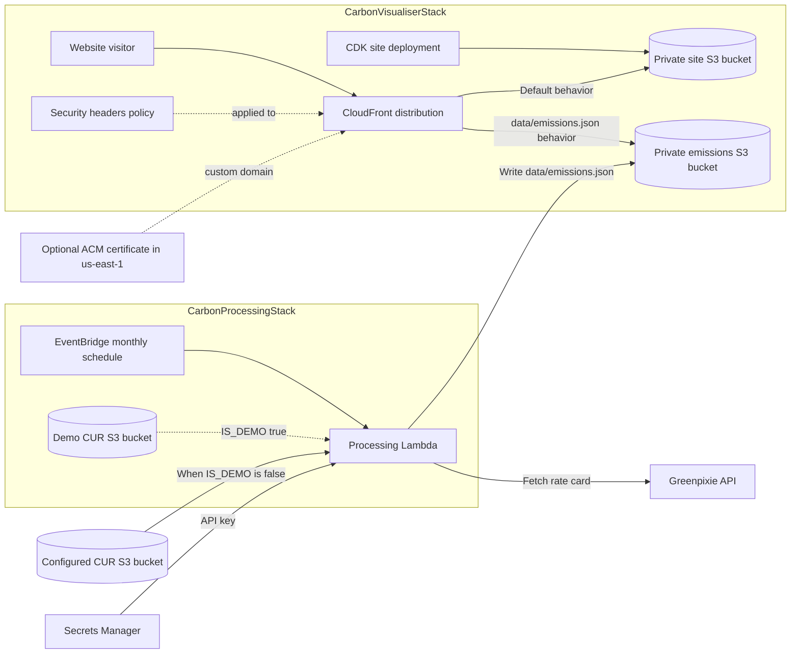

# Carbon Visualiser - Greenpixie

A demo project to visualise carbon emissions from an AWS account using the Greenpixie API.

Put GreenOps into practices by starting with visibility. Graph changes to carbon emissions over time.

<!-- Somewhere include a note that the demo app assumes a monthly cadence of billing export to align with GPX API changing over time; make that configurable? -->

## Architecture

The project has two independently deployable AWS CDK stacks, both defaulting to `eu-north-1`:



### `CarbonVisualiserStack`

- Deploys the static HTML/CSS/JavaScript site, locally vendored uPlot assets, and an emissions-data bucket.
- Uses private S3 origins with CloudFront Origin Access Control, HTTPS redirects, security headers, and no caching for `/data/emissions.json`.
- The site deployment manages only the site-assets bucket. The processing stack writes to the separate emissions bucket.

### `CarbonProcessingStack` (MVP)

MVP is a bounded experiment implemented as one scheduled TypeScript Lambda. It fetches Greenpixie’s rate card, reads one month of CUR CSV/GZIP files from S3, joins on `pricing_rate_code` and `pricing_unit`, aggregates emissions by service, and writes the public-safe `data/emissions.json` to a separate emissions bucket.

- EventBridge invokes the Lambda on the 4th of each month, after Greenpixie’s previous-month rate-card refresh. Invoke the Lambda manually with `{"gridPeriod":"2026-10"}` to test or rerun a period.
- MVP reads CSV and CSV/GZIP only; it does not read Parquet and does not require Glue, Athena, or Step Functions. Configure the CUR 2.0 export as CSV with GZIP for this test.
- The Lambda is configured for a 14-minute timeout and 4 GiB memory, with a default combined compressed-input limit of 64 MiB per month. Set `CUR_MAX_BYTES` to change the limit. If a month exceeds the cap or times out, stop increasing the limit and move the join to Phase 1.
- Lines without a rate code are skipped; a coded line without a Greenpixie factor fails the run rather than silently publishing an incomplete estimate.

#### Production grade version

The more scalable design is to catalog the CUR files with AWS Glue, run the rate-code join and aggregation in Athena SQL, and use Step Functions to coordinate rate-card retrieval, the long-running query, validation, and publication. Athena queries S3 directly; the Glue Data Catalog supplies table metadata. This requires extra setup and query/storage costs, so it is intentionally deferred until the MVP size/runtime cap is reached.

For replayability, improve the stack by storing a versioned GPX rate-card snapshot in private S3. Likewise right now the CUR billing data gets overwritten daily when a new screenshot is taken.

Visualisation improvements; at the moment the graph shows trends in carbon emissions, but doesn't account for changes in usage of each service. Attribution of changes shouldn't be done assuming that the emissions change is due to usage changes.

### ETL and platform choices

This is a small **ETL** pipeline: **Extract** usage files from S3 and rate-card factors from Greenpixie; **Transform** by joining on rate code and pricing unit, converting per-unit tonnes CO₂e to kg CO₂e, and aggregating by month/service; **Load** the validated, public-safe result into the emissions bucket. MVP does all three in one Lambda. It demonstrates automated data processing without a separate data-platform or BI vendor, although Greenpixie remains an external source/API dependency.

- **AWS-native MVP (chosen):** few services, low idle cost, simple to deploy, and data stays in your AWS account. The tradeoff is custom parsing/join code and Lambda’s runtime/memory limits; CSV/GZIP plus the 64 MiB cap is deliberately a test boundary.
- **AWS-native Phase 1:** Glue catalogs S3 data, Athena performs the SQL join, and Step Functions orchestrates fetch, query, validation, and publish. More scalable and easier to inspect with SQL, but adds setup, permissions, orchestration, and query costs.
- **Databricks:** a data-platform alternative, not just a chart. A scheduled Lakeflow Job can ingest CUR and Greenpixie data into Bronze/Silver/Gold Delta tables, run the join and quality checks, then expose a Gold aggregate through a Databricks SQL dashboard or SQL warehouse. This brings managed Spark/lakehouse capabilities and built-in job monitoring, at the cost of a Databricks workspace, platform spend, and platform-specific operations. Greenpixie itself uses Databricks internally; this project would still consume Greenpixie’s API.
- **Looker:** a BI/semantic layer over a SQL warehouse such as Databricks SQL. It helps with governed metrics and analyst-facing reports, but is not the ingestion or ETL engine and is a poor fit if the requirement is a small anonymous public page. The documented Databricks connection requires Unity Catalog and configured credentials/permissions ([Looker connection guide](https://docs.cloud.google.com/looker/docs/db-config-databricks)).
- **Grafana:** can query Athena directly for dashboards and alerting, or visualize an appropriate SQL source. It replaces the custom chart, not CUR ingestion and rate-card enrichment; public sharing, authentication, and operating Grafana still need consideration.
- **Static site + uPlot (chosen):** the smallest public presentation layer, no dashboard service or runtime third-party calls, and easy to serve through CloudFront. It intentionally offers fewer exploration, filtering, and alerting features than BI tools.

### Architecture trade offs and chocies for MVP vs Production Grade

- **MVP Lambda:** least infrastructure for proving the API join and JSON output; the 15-minute invocation limit and bounded CSV input make it unsuitable for large CUR exports. [AWS Lambda quotas](https://docs.aws.amazon.com/lambda/latest/dg/gettingstarted-limits.html)
- **Phase 1 Athena + Glue:** scales the S3 join with SQL, but needs a catalog/table and incurs query charges based on scanned data. [Athena overview](https://docs.aws.amazon.com/athena/latest/ug/what-is.html) · [Glue Data Catalog with Athena](https://docs.aws.amazon.com/athena/latest/ug/data-sources-glue.html)
- **Phase 1 Step Functions:** adds orchestration cost, but makes retries and long-running Athena queries observable; defer it until Athena is needed.
- **Static site + uPlot:** low-maintenance and suitable for one public time-series view; this is the chosen visualisation.
- **Grafana:** useful if already operated for dashboards and alerting, but more infrastructure and access-control work for a simple public page.
- **Databricks:** Can do the transformation as well as visualisation, so would replace the manual processing/joining done in the lambda. Used in the greenpixie data explorer course. Useful for a larger existing lakehouse or broader analytics, but probably overkill for for one account’s monthly chart.

For MVP’s supported CSV/GZIP format and the Greenpixie rate-code join, see [Greenpixie’s AWS CUR export guide](https://greenpixie.com/docs/guides/cloud-usage-data/aws) and [CUR enrichment guide](https://greenpixie.com/docs/guides/enrich-cur-api). The export guide recommends Parquet for larger-scale use; MVP deliberately uses its accepted CSV/GZIP option to keep the test Lambda dependency-light.

`site/carbon.txt` links to `site/data/site-footprint.json`, a placeholder for the separate page-view footprint estimate. After deploying the site, replace `example.com` and populate the estimate and methodology; this is not the Greenpixie AWS-account series.

### Development Guide

<!-- Add instructions here for spinning up your own version of this -->

Install the CDK dependencies and bootstrap the target account/Region once:

```sh
cd infrastructure
npm install
npx cdk bootstrap aws://ACCOUNT_ID/eu-north-1 --profile PROFILE
```

Copy `.env.dev` to `.env` in `infrastructure` and replace each `YOUR_...` placeholder. Both stacks load environment settings from this gitignored file.
Replace `PROFILE` in the commands below with a configured AWS CLI profile name. If using your default AWS credentials, omit the `--profile PROFILE` option.

Deploy the static site first and read its emissions bucket output:

```sh
npm run deploy:site -- --profile PROFILE
aws cloudformation describe-stacks \
  --stack-name CarbonVisualiserStack \
  --region eu-north-1 \
  --profile PROFILE \
  --query "Stacks[0].Outputs[?OutputKey=='EmissionsBucketName'].OutputValue | [0]" \
  --output text
```

For MVP, configure the AWS Data Export as CUR 2.0 CSV with GZIP compression; no Glue database or table is required.

Create the Greenpixie API key as a Secrets Manager secret in `eu-north-1`. Run the following bash script and enter the API key at the prompt; the command prints the secret ARN without printing the key:

```sh
printf 'Greenpixie API key: '
read -r -s GREENPIXIE_API_KEY
printf '\n'
printf '%s' "$GREENPIXIE_API_KEY" | aws secretsmanager create-secret \
  --name greenpixie-api-key \
  --secret-string file:///dev/stdin \
  --region eu-north-1 \
  --query ARN \
  --output text
unset GREENPIXIE_API_KEY
```

Copy the returned ARN into `GREENPIXIE_SECRET_ARN` in `infrastructure/.env`. To update an existing secret, use `put-secret-value --secret-id greenpixie-api-key` in place of `create-secret --name greenpixie-api-key`. Then deploy the processing stack independently:


```sh
npm run deploy:processing -- --profile PROFILE
```

After deploying, manually process a completed period before relying on the monthly schedule:

```sh
aws lambda invoke \
  --function-name PROCESSING_LAMBDA_NAME \
  --region eu-north-1 \
  --profile PROFILE \
  --cli-binary-format raw-in-base64-out \
  --payload '{"gridPeriod":"2026-10"}' \
  /tmp/carbon-processing-result.json
cat /tmp/carbon-processing-result.json
```

Set `CUR_DATA_PREFIX` to the path immediately before `/data/BILLING_PERIOD=YYYY-MM/`, for example `billing/greenpixie-cur2`.


### Using the demo version of this app

Run this as a demo if you want to show how the visualisation might work for you or your organisation, but don't want to commit to the paid API yet and (like me!) you don't have any real reporting data with EC2 SKUs.

Set IS_DEMO true in your env variables, then deploy the stack. Keep track of the returned demo bucket name. Use it in the following command to add some dummy data. You'll need to set the bucket name, the same CUR prefix, and to set the billing period to "now" in year and month or the lambda will not find the file.

```bash
aws s3 cp ../dummy-data/sample_aws_usage_data.csv.gz \
  "s3://<DEMO_BUCKET_NAME>/<CUR_DATA_PREFIX>/data/BILLING_PERIOD=<UPDATE_TO_NOW_YYYY-MM>/sample_aws_usage_data.csv.gz" \
  --region eu-north-1 \
```


## Greenpixie Methodology

Greenpixie's cloud methodology calculates energy, carbon, water, and embodied emissions metrics for public cloud service usage, at the granularity of individual units of cloud usage.

## TODO

- [ ] Add Lambda tests for Greenpixie pagination, duplicate rate-card keys, unmatched CUR rows, size-cap failure, and merging a new month into emissions history.
- [ ] Deploy processing stack then manually invoke the processing Lambda for one period; compare the result with Greenpixie or a hand-calculated sample. Add a dummy data bucket and upload the Greenpixie dummy data from the data explorer
- [ ] If the period exceeds the size cap or timeout, implement the Phase 1 Glue/Athena/Step Functions pipeline and validate the join with SQL.
- [ ] Explore feeding emissions into CloudWatch or CloudHealth for alerts: https://greenpixie.com/docs/guides/cloudhealth-integration-aws

## Glossary

- CUR: Cost and Usage Report, billing data from AWS
- Rate Card: emissions data per service from Greenpixie
- SKU: typically Stock Keeping Unit, a unique identifier of a product. In this case, AWS services.
- BI: Business Intelligence
