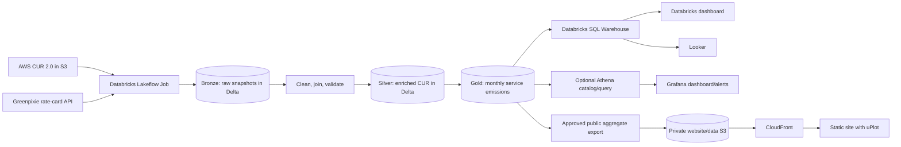
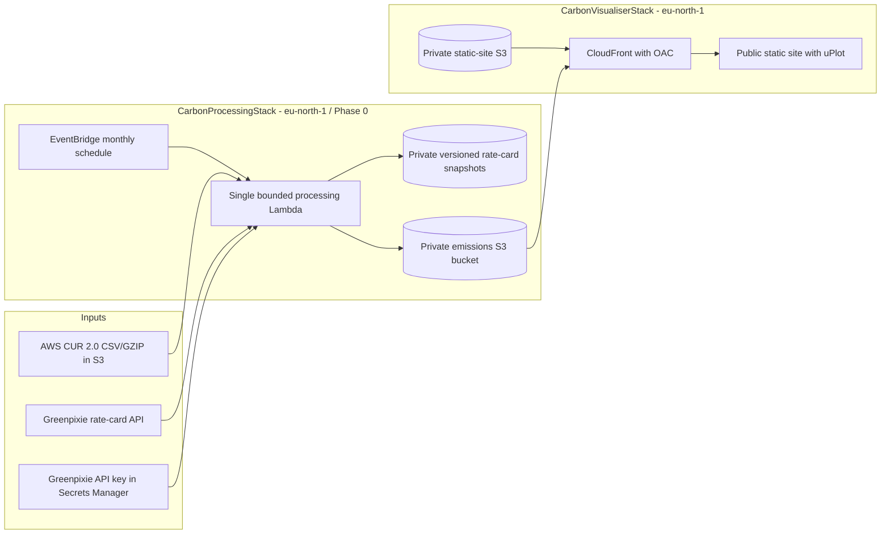

# Carbon Visualiser - Greenpixie

A toy project to visualise carbon emissions from an AWS account using the Greenpixie API.

Put GreenOps into practices by starting with visibility. Graph changes to carbon emissions over time.

## Architecture

The project has two independently deployable AWS CDK stacks, both defaulting to `eu-north-1`:

### `CarbonVisualiserStack`

- Deploys the static HTML/CSS/JavaScript site, locally vendored uPlot assets, and an emissions-data bucket.
- Uses private S3 origins with CloudFront Origin Access Control, HTTPS redirects, security headers, and no caching for `/data/emissions.json`.
- The site deployment manages only the site-assets bucket. The processing stack writes to the separate emissions bucket.

### `CarbonProcessingStack` (Phase 0)

Phase 0 is a bounded experiment implemented as one scheduled TypeScript Lambda. It fetches Greenpixie’s rate card, reads one month of CUR CSV/GZIP files from S3, joins on `pricing_rate_code` and `pricing_unit`, aggregates emissions by service, and writes the public-safe `data/emissions.json` to the separate emissions bucket. It also stores a versioned rate-card snapshot in private S3.

- EventBridge invokes the Lambda on the 4th of each month, after Greenpixie’s previous-month rate-card refresh. Invoke the Lambda manually with `{"gridPeriod":"2026-10"}` to test or rerun a period.
- Phase 0 reads CSV and CSV/GZIP only; it does not read Parquet and does not require Glue, Athena, or Step Functions. Configure the CUR 2.0 export as CSV with GZIP for this test.
- The Lambda is configured for a 14-minute timeout and 4 GiB memory, with a default combined compressed-input limit of 64 MiB per month. Set `CUR_MAX_BYTES` to change the limit. If a month exceeds the cap or times out, stop increasing the limit and move the join to Phase 1.
- Lines without a rate code are skipped; a coded line without a Greenpixie factor fails the run rather than silently publishing an incomplete estimate.
- Run `npm run test:processing` from `infrastructure/` for the local TypeScript transformation tests.

### Phase 1 (when Phase 0 reaches its limits)

The more scalable design is to catalog the CUR files with AWS Glue, run the rate-code join and aggregation in Athena SQL, and use Step Functions to coordinate rate-card retrieval, the long-running query, validation, and publication. Athena queries S3 directly; the Glue Data Catalog supplies table metadata. This requires extra setup and query/storage costs, so it is intentionally deferred until the Phase 0 size/runtime cap is reached.

### ETL and platform choices

This is a small **ETL** pipeline: **Extract** usage files from S3 and rate-card factors from Greenpixie; **Transform** by joining on rate code and pricing unit, converting per-unit tonnes CO₂e to kg CO₂e, and aggregating by month/service; **Load** the validated, public-safe result into the emissions bucket. Phase 0 does all three in one Lambda. It demonstrates automated data processing without a separate data-platform or BI vendor, although Greenpixie remains an external source/API dependency.

- **AWS-native Phase 0 (chosen):** few services, low idle cost, simple to deploy, and data stays in your AWS account. The tradeoff is custom parsing/join code and Lambda’s runtime/memory limits; CSV/GZIP plus the 64 MiB cap is deliberately a test boundary.
- **AWS-native Phase 1:** Glue catalogs S3 data, Athena performs the SQL join, and Step Functions orchestrates fetch, query, validation, and publish. More scalable and easier to inspect with SQL, but adds setup, permissions, orchestration, and query costs.
- **Databricks:** a data-platform alternative, not just a chart. A scheduled Lakeflow Job can ingest CUR and Greenpixie data into Bronze/Silver/Gold Delta tables, run the join and quality checks, then expose a Gold aggregate through a Databricks SQL dashboard or SQL warehouse. This brings managed Spark/lakehouse capabilities and built-in job monitoring, at the cost of a Databricks workspace, platform spend, and platform-specific operations. Greenpixie itself uses Databricks internally; this project would still consume Greenpixie’s API.
- **Looker:** a BI/semantic layer over a SQL warehouse such as Databricks SQL. It helps with governed metrics and analyst-facing reports, but is not the ingestion or ETL engine and is a poor fit if the requirement is a small anonymous public page. The documented Databricks connection requires Unity Catalog and configured credentials/permissions ([Looker connection guide](https://docs.cloud.google.com/looker/docs/db-config-databricks)).
- **Grafana:** can query Athena directly for dashboards and alerting, or visualize an appropriate SQL source. It replaces the custom chart, not CUR ingestion and rate-card enrichment; public sharing, authentication, and operating Grafana still need consideration.
- **Static site + uPlot (chosen):** the smallest public presentation layer, no dashboard service or runtime third-party calls, and easy to serve through CloudFront. It intentionally offers fewer exploration, filtering, and alerting features than BI tools.

#### Alternative platform architecture

Use this if the goal shifts from a lightweight public chart to a managed analytics workspace. The ETL/Gold aggregate stays private; publish only approved aggregate data for a public website. Alternatively, keep the dashboard private inside Databricks, Looker, or Grafana.



In this alternative, choose one dashboard path rather than deploying all three: Databricks dashboards for an all-in-one lakehouse workflow, Looker for governed BI on a SQL warehouse, Grafana for operational dashboards/alerts, or the existing static site for anonymous public access. Databricks documents scheduled multi-task data jobs in [Lakeflow Jobs](https://docs.databricks.com/aws/en/jobs), Delta Lake tables and medallion-style pipelines in [Delta Lake](https://docs.databricks.com/aws/en/delta), and sharing/scheduling in [dashboards](https://docs.databricks.com/aws/en/dashboards/). Grafana documents its [Athena datasource](https://grafana.com/docs/plugins/grafana-athena-datasource/latest/), which can query and visualize Athena data directly.

### Data flow



### Tradeoffs

- **Phase 0 Lambda:** least infrastructure for proving the API join and JSON output; the 15-minute invocation limit and bounded CSV input make it unsuitable for large CUR exports. [AWS Lambda quotas](https://docs.aws.amazon.com/lambda/latest/dg/gettingstarted-limits.html)
- **Phase 1 Athena + Glue:** scales the S3 join with SQL, but needs a catalog/table and incurs query charges based on scanned data. [Athena overview](https://docs.aws.amazon.com/athena/latest/ug/what-is.html) · [Glue Data Catalog with Athena](https://docs.aws.amazon.com/athena/latest/ug/data-sources-glue.html)
- **Phase 1 Step Functions:** adds orchestration cost, but makes retries and long-running Athena queries observable; defer it until Athena is needed.
- **Static site + uPlot:** low-maintenance and suitable for one public time-series view; this is the chosen visualisation.
- **Grafana:** useful if already operated for dashboards and alerting, but more infrastructure and access-control work for a simple public page.
- **Databricks:** Can do the transformation as well as visualisation, so would replace the manual processing/joining done in the lambda. Used in the greenpixie data explorer course. Useful for a larger existing lakehouse or broader analytics, but probably overkill for  for one account’s monthly chart.

For Phase 0’s supported CSV/GZIP format and the Greenpixie rate-code join, see [Greenpixie’s AWS CUR export guide](https://greenpixie.com/docs/guides/cloud-usage-data/aws) and [CUR enrichment guide](https://greenpixie.com/docs/guides/enrich-cur-api). The export guide recommends Parquet for larger-scale use; Phase 0 deliberately uses its accepted CSV/GZIP option to keep the test Lambda dependency-light.

The checked-in `site/data/emissions.json` and `site/data/demo-emissions.json` contain illustrative values only; neither uses AWS billing or Greenpixie data. The site falls back to demo values until the emissions bucket has generated data. Replace them only with validated aggregates before presenting live account emissions publicly.

`site/carbon.txt` links to `site/data/site-footprint.json`, a placeholder for the separate page-view footprint estimate. After deploying the site, replace `example.com` and populate the estimate and methodology; this is not the Greenpixie AWS-account series.

### Deploy independently

Install the CDK dependencies and bootstrap the target account/Region once:

```sh
cd infrastructure
npm install
npx cdk bootstrap aws://ACCOUNT_ID/eu-north-1 --profile PROFILE
```

Deploy the static site first and read its emissions bucket output:

```sh
npm run deploy:site -- --profile PROFILE
aws cloudformation describe-stacks \
  --stack-name CarbonVisualiserStack \
  --region eu-north-1 \
  --profile PROFILE \
  --query "Stacks[0].Outputs[?OutputKey=='EmissionsBucketName'].OutputValue | [0]" \
  --output text
```

For Phase 0, configure the AWS Data Export as CUR 2.0 CSV with GZIP compression; no Glue database or table is required. Create the Greenpixie API key as a Secrets Manager secret in `eu-north-1`, then deploy the processing stack independently:

```sh
export AWS_REGION=eu-north-1
export EMISSIONS_BUCKET_NAME=YOUR_EMISSIONS_BUCKET
export CUR_BUCKET_NAME=YOUR_CUR_BUCKET
export CUR_DATA_PREFIX=YOUR_EXPORT_NAME_PREFIX
export CUR_MAX_BYTES=67108864
export GREENPIXIE_SECRET_ARN=arn:aws:secretsmanager:eu-north-1:ACCOUNT_ID:secret:YOUR_SECRET
npm run deploy:processing -- --profile PROFILE
```

After deploying, manually process a completed period before relying on the monthly schedule:

```sh
aws lambda invoke \
  --function-name PROCESSING_LAMBDA_NAME \
  --region eu-north-1 \
  --profile PROFILE \
  --cli-binary-format raw-in-base64-out \
  --payload '{"gridPeriod":"2026-10"}' \
  /tmp/carbon-processing-result.json
cat /tmp/carbon-processing-result.json
```

Set `CUR_DATA_PREFIX` to the path immediately before `/data/BILLING_PERIOD=YYYY-MM/`, for example `billing/greenpixie-cur2`. 


## Greenpixie Methodology

Greenpixie's cloud methodology calculates energy, carbon, water, and embodied emissions metrics for public cloud service usage, at the granularity of individual units of cloud usage.

## TODO

- [ ] Add Lambda tests for Greenpixie pagination, duplicate rate-card keys, unmatched CUR rows, size-cap failure, and merging a new month into emissions history.
- [ ] Deploy processing stack then manually invoke the processing Lambda for one period; compare the result with Greenpixie or a hand-calculated sample. Add a dummy data bucket and upload the Greenpixie dummy data fromt he data explorer 
- [ ] If the period exceeds the size cap or timeout, implement the Phase 1 Glue/Athena/Step Functions pipeline and validate the join with SQL.
- [ ] Explore feeding emissions into CloudWatch or CloudHealth for alerts: https://greenpixie.com/docs/guides/cloudhealth-integration-aws

## Glossary

- CUR: Cost and Usage Report, billing data from AWS
- Rate Card: emissions data per service from Greenpixie
- SKU: typically Stock Keeping Unit, a unique identifier of a product. In this case, AWS services.
- BI: Business Intelligence
