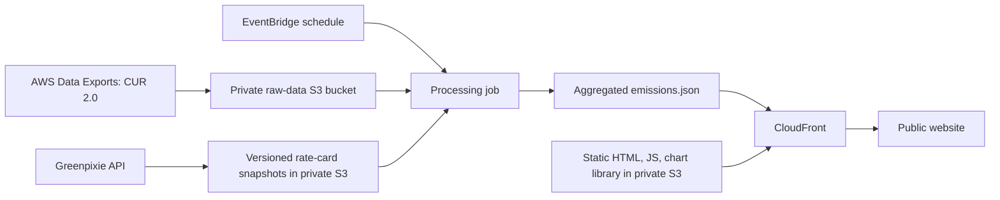

# Carbon Visualiser - Greenpixie

A toy project to visualise  carbon emissions from an AWS account using the Greenpixie API.

Put GreenOps into practices by starting with visibility. Graph changes to carbon emissions over time. 

## Architecture

The data visualiser is a statically generated website served directly from S3 using the common graphing library Blah. 

### Data provisioning infrastructure includes:
- Data export from billing configured via AWS console, currently set hourly (will update to daily).
- Data export bucket S3 bucket and policy as per [greenpixie docs](https://greenpixie.com/docs/guides/cloud-usage-data/aws), configured via console. Bucket objects prefixed with data of data pull.
- Lambda runs when on ObjectCreate in the export bucket. Calls the Greenpixie API for most up to date rate card data (see below definition of rate card data).
- Greenpixie rate card data storage bucket, configured via console. Bucket objects prefixed with data of data pull.
- Lambda to join data and output a third file with combined data -  billing info with rate card, multiplied to output a carbon per service. Following Greenpixie API [docs](https://greenpixie.com/docs/guides/enrich-cur-api) on joining data.
- Lambda outputs emissions.json file for use by visualiser website, containing only publically safe data and nothing operationally sensitive.
(Alternatively, run a cron instead: CUR exports can arrive as many objects, lambda may be triggered before they all arrive. Revisit this to have the lambda invoked by a scheduled job instead!)
- Once cadence is established, object expiry will be added to source files to avoid retaining massive amounts of data.

### Visualisation infrastructure includes:
- A static HTML, CSS and JavaScript site in `site/`. The uPlot browser bundle, stylesheet, and license are vendored under `site/vendor/`, so the page makes no third-party runtime requests and needs no package manager in production.
- A private S3 bucket and CloudFront distribution configured by the TypeScript CDK app in `infrastructure/`. CloudFront uses Origin Access Control, HTTPS-only viewer access, security headers, and a no-cache behavior for `data/emissions.json`. CDK deploys the contents of `site/` and invalidates the distribution on updates.
- `site/data/emissions.json` is illustrative demo data only. It is not connected to AWS billing or Greenpixie and must be replaced with approved, aggregated emissions data before publication as real account data.
- `site/carbon.txt` links to `site/data/site-footprint.json`, which is deliberately a placeholder. After deployment, replace `example.com` with the live site domain and populate the page-view estimate and methodology; this is separate from the Greenpixie AWS account series.
Note: discarded graphana as a potential alternative visualisation option for this data source as YAGNI, but can revisit

### Deploy the visualiser

Install the CDK dependencies and set up the target account/Region once. Bootstrapping creates CDK's deployment resources in that environment. Replace the placeholders with your AWS account ID, Region, and configured CLI profile:

```sh
cd infrastructure
npm install
npx cdk bootstrap aws://ACCOUNT_ID/REGION --profile PROFILE
```

Deploy the stack and website:

```sh
npm run deploy -- --profile PROFILE
```

The deploy output includes `SiteUrl`, `SiteBucketName`, and `DistributionId`. `BucketDeployment` uploads the site and invalidates CloudFront when assets change. `data/emissions.json` has caching disabled so replacement data becomes visible promptly.

Bootstrap is needed once per AWS account and Region. For the default AWS CLI profile, omit `--profile PROFILE` from both commands. This CDK app deploys only the public visualisation layer; it does not create the billing export, Greenpixie integration, or emissions calculation pipeline.


<!-- todo:Could choose not to store the GPX data independently but keeping snapshots makes results reproducible -->

<!-- Note: athena is the typical data processing tool of choice, but with the API call in the mix and small volume of data, lambda is good enough and will be able to cope with the processing time. If the lambda starts to hit timeouts, move to athena -->

<!-- todo: because buckets get big quickly, object expiry is set at 3 months. TBD really, could yeet them into cold storage?_ -->

<!-- _note: to run this as a workshop, provide some IAC for folks to deploy_ -->




## Greenpixie Methodology

Rate card data means the emissions calculated for a given service, using a particular Greenpixie methodology.


## Next steps
Integrate the Greenpixie data back into CLoudwatch to configure carbon alerts

https://greenpixie.com/docs/guides/cloudhealth-integration-aws


## Glossary
- Cost and Usage Report (CUR): Billing data from AWS
- Rate Card: emissions data per service from Greenpixie