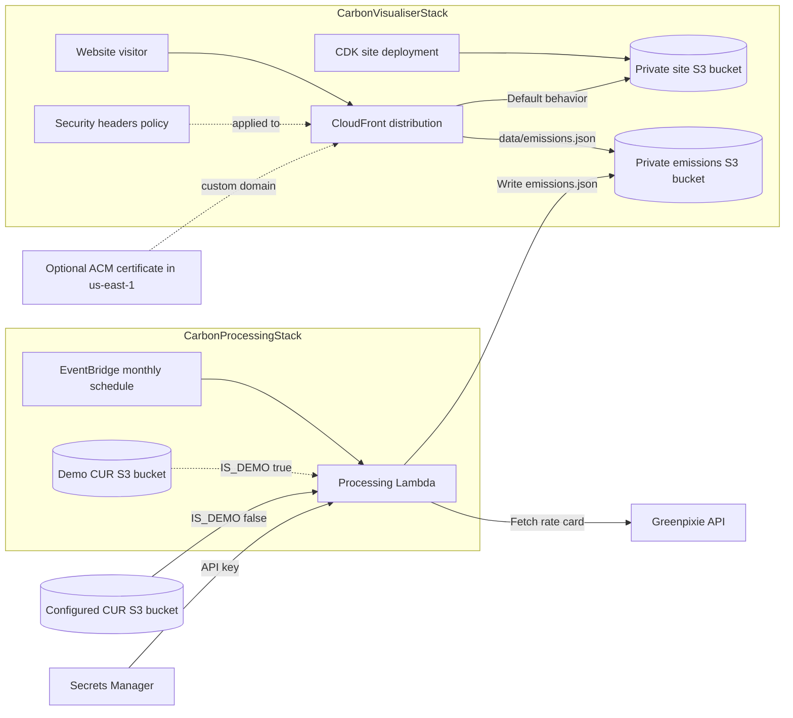

# Architecture and design decisions 🏗️

This document explains how Carbon Visualiser is put together, why the current implementation is deliberately small, and how the architecture could evolve beyond a demonstration.

For instructions on deploying and trying the application, see the [Getting started guide](../README.md).

## The design goal

The central question this project explores is:

> Can we combine AWS usage data with Greenpixie's emissions data and turn it into a useful visualisation?

The initial scope is intentionally narrow:

- one AWS account;
- monthly billing data;
- Greenpixie rate-card enrichment;
- emissions aggregated by month and service;
- one simple dashboard.

This is enough to demonstrate the integration and explore the resulting data without first building a full data platform.

## Architecture overview

The application is split into two independently deployable AWS CDK stacks. Both default to `eu-north-1`.



### `CarbonProcessingStack`

The MVP is a bounded ETL pipeline implemented as a scheduled TypeScript Lambda.

For each billing period, it:

1. reads AWS CUR CSV/GZIP files from S3;
2. retrieves the Greenpixie rate card;
3. joins the datasets using `pricing_rate_code` and `pricing_unit`;
4. converts per-unit tonnes CO₂e into kg CO₂e;
5. aggregates emissions by month and service;
6. validates the result;
7. writes a public-safe `data/emissions.json` file to a separate emissions bucket.

EventBridge invokes the Lambda on the 4th of each month, after Greenpixie's previous-month rate-card refresh.

The Lambda can also be invoked manually with a period, for example:

```json
{ "gridPeriod": "2026-10" }
```

The MVP supports CSV and CSV/GZIP only. It does not use Glue, Athena or Step Functions.

Current processing boundaries:

| Setting                                 |             Value |
| --------------------------------------- | ----------------: |
| Lambda timeout                          |        14 minutes |
| Lambda memory                           |             4 GiB |
| Default combined compressed-input limit |            64 MiB |
| Processing unit                         | One billing month |

`CUR_MAX_BYTES` can be used to change the input-size limit. If a month exceeds the cap or the Lambda times out, the next step should be to move the join to the Phase 1 architecture, rather than continually increasing Lambda resources.

Lines without a rate code are skipped. A coded line without a matching Greenpixie factor fails the run rather than silently publishing an incomplete estimate.

### `CarbonVisualiserStack`

The visualisation stack deploys:

- the static HTML/CSS/JavaScript site;
- locally vendored uPlot assets;
- a private site-assets S3 bucket;
- a separate private emissions-data S3 bucket;
- a CloudFront distribution;
- Origin Access Control;
- HTTPS redirects;
- a security headers policy.

CloudFront serves the site from the site bucket and routes requests for `/data/emissions.json` to the emissions bucket.

The site deployment manages only the site-assets bucket. The processing stack writes to the separate emissions bucket.

This separation means the browser can retrieve the generated dataset without either S3 bucket being public. The Greenpixie API key remains in Secrets Manager and is only used by the processing Lambda.

## Why a Lambda?

For this experiment, a single Lambda is the smallest reasonable way to prove the data integration.

It can:

- retrieve the rate card;
- read the CUR files;
- perform the join and aggregation;
- publish the result.

That keeps the infrastructure easy to deploy and understand. There is no need to introduce a data catalogue, query engine or workflow orchestrator just to process one small monthly dataset.

The trade-off is that Lambda has finite execution time, memory and temporary storage. It also means the application owns the CSV parsing, joining and validation logic.

That's acceptable for a bounded demonstration. It is not a good general-purpose architecture for large or unpredictable CUR exports.

## What would change for production?

The natural next step is to move the data processing into services designed for larger datasets and longer-running workflows.

One possible AWS-native architecture:

```text
                    ┌── AWS Glue Data Catalog
CUR files ── S3 ────┤
                    └── Athena SQL
                           │
Greenpixie API ──> rate-card snapshot
                           │
                    Step Functions
                           │
                    validation / publish
                           │
                       S3 output
```

### Glue Data Catalog + Athena

AWS Glue would catalogue the CUR data, allowing Athena to query the files directly in S3.

Athena could perform the rate-code join and aggregation using SQL rather than loading the entire dataset into Lambda memory.

This would be a better fit for larger CUR exports and make the transformation easier to inspect and modify.

The trade-offs are additional configuration, IAM permissions, catalog management and Athena query costs.

- [Athena overview](https://docs.aws.amazon.com/athena/latest/ug/what-is.html)
- [Using the Glue Data Catalog with Athena](https://docs.aws.amazon.com/athena/latest/ug/data-sources-glue.html)

### Step Functions

Step Functions could coordinate the longer-running stages:

1. retrieve the Greenpixie rate card;
2. start the Athena query;
3. wait for query completion;
4. validate the results;
5. publish the new dataset.

This adds orchestration and retry visibility, but also introduces another service to configure and operate.

It is not needed while the processing job fits comfortably inside one Lambda invocation.

### Preserve source data and rate-card versions

A production implementation should preserve the inputs used to generate each result.

At the moment, the processing Lambda retrieves the current Greenpixie rate card when it runs. Storing versioned rate-card snapshots in private S3 would make it possible to reproduce historical calculations using the same emissions factors.

Likewise, CUR data should be retained rather than overwritten as new exports arrive.

This is important for replayability, comparison and auditability.

## Other platform options

The processing and presentation layers are separate design decisions. A different visualisation tool does not remove the need to ingest and enrich the underlying data.

### Databricks

Databricks could handle both transformation and visualisation.

A larger implementation might use a scheduled Lakeflow Job to ingest CUR and Greenpixie data into Bronze/Silver/Gold Delta tables, perform the join and quality checks, and expose a Gold aggregate through Databricks SQL.

This is a good option for an organisation that already has a Databricks lakehouse or wants to combine the data with broader analytics.

It brings managed Spark/lakehouse capabilities and built-in job monitoring, but requires a Databricks workspace, platform spend and platform-specific operations.

Greenpixie uses Databricks internally, and its Data Explorer course demonstrates working with Greenpixie data in that environment. This project still consumes Greenpixie's API; it doesn't depend on Greenpixie's internal platform.

### Grafana

Grafana could query Athena or another suitable SQL source to provide dashboards and alerting.

It would replace the custom chart, not the CUR ingestion and rate-card enrichment pipeline.

It makes particular sense if an organisation already operates Grafana. For a single public chart, however, operating Grafana and managing public access would add unnecessary complexity.

### Looker

Looker is a BI and semantic layer over a SQL warehouse such as Databricks SQL.

It is useful for governed metrics and analyst-facing reports, but it is not an ingestion or ETL engine.

It is also a poor fit for this project's small anonymous public page. The documented Databricks connection requires Unity Catalog and configured credentials and permissions.

See the [Looker Databricks connection guide](https://docs.cloud.google.com/looker/docs/db-config-databricks).

## Why a static site and uPlot?

The dashboard currently needs one thing: a lightweight way to display emissions over time.

A static site with locally vendored [uPlot](https://github.com/leeoniya/uPlot) is enough to do that.

It provides:

- a small presentation layer;
- no dashboard service to operate;
- no runtime third-party calls from the browser;
- straightforward hosting through CloudFront;
- a simple way to share the result.

The trade-off is that it doesn't provide the richer filtering, exploration, alerting or governance features of a BI platform.

That is a reasonable compromise for this project's scope.

## Data and methodology considerations

There are some important limitations in what the current visualisation tells us.

### Emissions changes are not necessarily usage changes

The graph shows emissions over time, but it does not currently account for changes in service usage or attempt to attribute the cause of an emissions change.

A change could reflect:

- more or less resource usage;
- a different mix of services;
- changes in Greenpixie's emissions factors;
- changes in underlying grid or other data.

The visualisation should therefore be read as a trend, not as an explanation of what caused it.

### Monthly processing and changing data

The current processing schedule runs on the 4th of each month, after Greenpixie's previous-month rate-card refresh.

This gives the application a predictable monthly processing cadence. It also means the dashboard does not currently explore finer-grained changes in carbon intensity, such as differences between running workloads at different times of day.

That would be a useful area to investigate in a more detailed implementation.

### Data completeness

The processing Lambda skips CUR lines without a rate code, but fails if a coded line has no corresponding Greenpixie factor.

This is deliberate: publishing a partial result without making the data gap visible could be misleading.

A production pipeline would benefit from more comprehensive data-quality reporting and validation.

## Summary of the choices

| Area          | MVP choice           | Why                                                | When to reconsider                                      |
| ------------- | -------------------- | -------------------------------------------------- | ------------------------------------------------------- |
| Processing    | TypeScript Lambda    | Minimal infrastructure for a small monthly dataset | Input size or runtime exceeds the defined boundary      |
| Data query    | In-memory CSV join   | Simple to implement and reproduce                  | Larger datasets or more complex transformations         |
| Orchestration | EventBridge schedule | One predictable monthly job                        | Multiple dependent or long-running stages               |
| Storage       | S3                   | Simple, low-cost object storage                    | More advanced data lifecycle or analytical requirements |
| Presentation  | Static site + uPlot  | One lightweight public chart                       | More complex dashboards, filtering or alerting          |
| Delivery      | CloudFront           | HTTPS delivery without public S3 buckets           | Additional access-control or distribution needs         |

The guiding principle is to use the smallest architecture that demonstrates the idea, while being explicit about the point at which that architecture stops being appropriate.

## Further reading

- [Greenpixie AWS CUR export guide](https://greenpixie.com/docs/guides/cloud-usage-data/aws)
- [Greenpixie CUR enrichment guide](https://greenpixie.com/docs/guides/enrich-cur-api)
- [AWS Lambda quotas](https://docs.aws.amazon.com/lambda/latest/dg/gettingstarted-limits.html)
- [Amazon Athena overview](https://docs.aws.amazon.com/athena/latest/ug/what-is.html)
- [Glue Data Catalog with Athena](https://docs.aws.amazon.com/athena/latest/ug/data-sources-glue.html)
